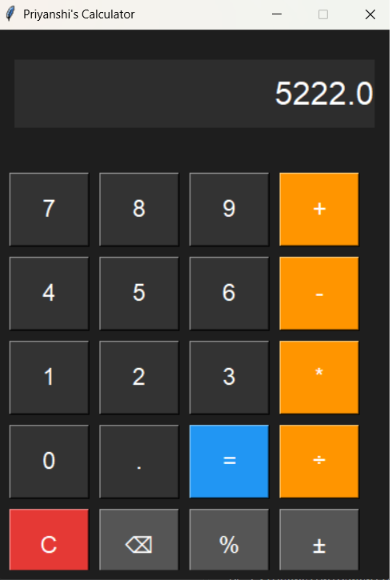

# BTech CSE First Year

Hi, I'm Priyanshi Guha.

This repository contains my first-year BTech CSE projects.

## Projects

### 1. GUI Calculator

A graphical calculator built using Python and Tkinter.

**Features:**
- Addition, subtraction, multiplication and division
- Percentage calculation
- Positive/negative number conversion
- Clear and Backspace buttons
- User-friendly graphical interface

**Technology:** Python, Tkinter

**Screenshot:**

**How to Run:**

1. Clone this repository.
2. Open the project folder in VS Code.
3. Run the following command:

```bash
python calculator_gui.py

### 2. Random Password Generator

A Python program that generates random passwords using letters, numbers, and symbols.

**Features:**
- Random password generation
- Combination of letters, numbers and symbols
- Helps create unique passwords

**Technology:** Python

## Technologies & Tools

- Python
- Tkinter (GUI Development)
- Visual Studio Code
- Git & GitHub